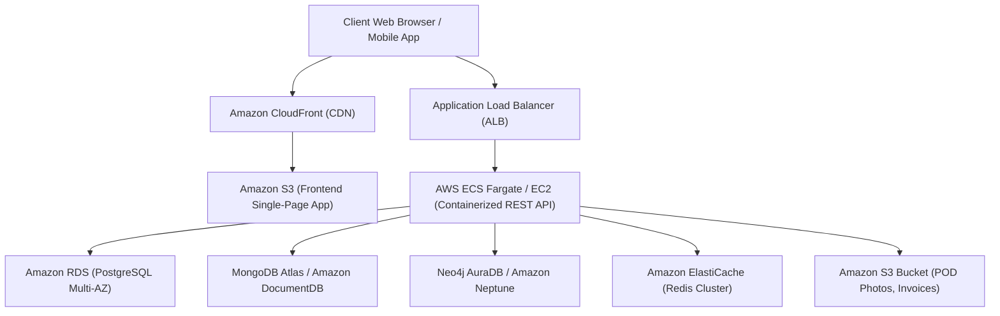

# Cloud Architecture & AWS Deployment Guide

## 1. Cloud Architecture Overview

The Logistics Management System is designed for production deployment on **Amazon Web Services (AWS)** using managed services that satisfy enterprise scalability, resilience, and high availability while remaining **100% cost-optimized for student projects**.



---

## 2. Cloud Service Mapping

| Component | Cloud Service | Purpose in LMS | Student Tier / Cost-Effective Option |
| :--- | :--- | :--- | :--- |
| **Relational Database** | **Amazon RDS PostgreSQL** | Transactional orders, catalog, inventory, payments, and ACID enforcement. | **db.t4g.micro** (Free under AWS Free Tier: 750 hrs/month). |
| **NoSQL Database** | **MongoDB Atlas / DocumentDB** | Semi-structured shipment tracking history, IoT telemetry, and audit logs. | **MongoDB Atlas M0 Free Cluster** (512MB RAM, shared CPU, $0.00/mo). |
| **Graph Database** | **Neo4j AuraDB / AWS Neptune** | Interstate corridor topology, connected locations, and Dijkstra routing. | **Neo4j AuraDB Free Tier** (1 instance, 200k nodes, 400k edges, $0.00/mo). |
| **In-Memory Cache** | **Amazon ElastiCache Redis** | Offloading read latency for product catalogs and inventory levels. | **cache.t4g.micro** (Free tier eligible) or local Redis container. |
| **Cloud Storage** | **Amazon S3** | Proof of delivery (POD) photographs, driver digital signatures, and waybills. | **S3 Standard** (Free Tier includes 5GB storage, 20,000 GETs, 2,000 PUTs). |
| **Backend Compute** | **AWS ECS Fargate / Elastic Beanstalk** | Node.js REST API with automated health checks and auto-scaling. | Single **t4g.small / t3.micro** EC2 instance under Free Tier. |
| **Edge CDN** | **Amazon CloudFront** | Low-latency global distribution of frontend HTML/CSS/JS dashboard. | 1TB free data transfer out per month. |

---

## 3. High Availability, Scalability & Disaster Recovery

### 3.1 Read-Write Split & Horizontal Scaling
* **Write Operations (Transactions)**: Directed to the **RDS PostgreSQL Primary Writer Instance**.
* **Read Operations (Catalog & Dashboards)**: Distributed across **RDS Read Replicas** across multiple Availability Zones (AZs) combined with **Amazon ElastiCache Redis**.

### 3.2 Automated Backup & Point-In-Time Recovery (PITR)
* Amazon RDS performs automated daily full volume snapshots and continuous transaction log (WAL) archiving to S3 every 5 minutes.
* Enables **Point-In-Time Recovery (PITR)** down to the second, protecting against accidental table drops or malicious data corruption.

### 3.3 Proof of Delivery (POD) S3 Lifecycle Rules
* Digital delivery receipts and signature images uploaded to S3 transition from **S3 Standard** to **S3 Standard-Infrequent Access (IA)** after 90 days, and archive to **S3 Glacier Deep Archive** after 365 days, cutting cloud storage costs by **95%**.

---

## 4. Step-by-Step Local & Cloud Run Instructions

### Option A: Local Run (Zero Friction - Works Everywhere)
1. Ensure Node.js (v18+) is installed.
2. Open terminal in project root directory:
   ```powershell
   cd "C:\Users\Rishi Raj Singh\.gemini\antigravity\scratch\logistics-management-system"
   ```
3. Start the application:
   ```powershell
   node server.js
   ```
4. Open your browser and navigate to:
   ```
   http://localhost:5000
   ```
5. All database operations, ACID transactions, Dijkstra route algorithms, NoSQL tracking logs, and Redis caching will run out-of-the-box!

### Option B: Deploying to AWS Elastic Beanstalk / EC2
1. Initialize Git repository and commit files:
   ```bash
   git init && git add . && git commit -m "Initial commit of Logistics Management System"
   ```
2. Initialize Elastic Beanstalk environment:
   ```bash
   eb init -p node.js logistics-ims --region us-east-1
   eb create logistics-prod-env --single
   ```
3. Set production environment variables in AWS:
   ```bash
   eb setenv NODE_ENV=production PORT=80 JWT_SECRET=prod_super_secret_key_2026
   ```
4. Access the generated AWS Elastic Beanstalk public URL (e.g. `http://logistics-prod-env.elasticbeanstalk.com`).
