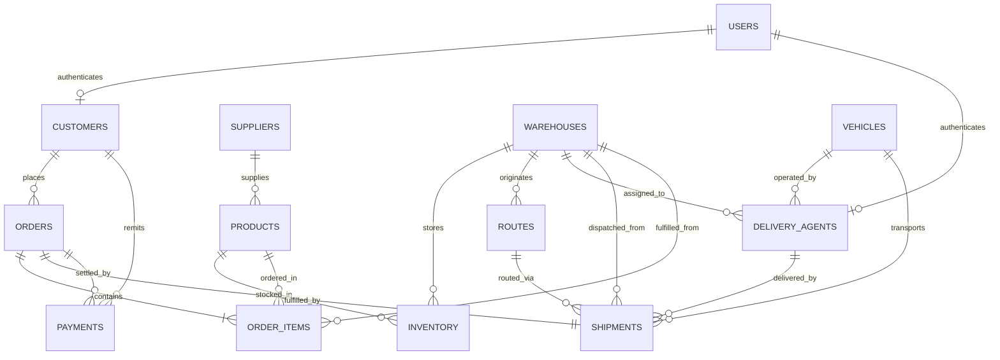

# Database Design, Schema Specification & ER Diagram

## 1. System Overview
The **Logistics Management System (LMS)** is a database-centric Information Management System engineered to demonstrate core and advanced database concepts. The relational database serves as the bedrock of structural integrity, financial consistency, and strict transaction handling.

---

## 2. Entity-Relationship (ER) Diagram

---

## 3. Relational Table Specifications & Data Dictionary

### 3.1 `users` Table
Stores authenticated credentials, password hashes, and system access roles.
* **`id`**: `INT PRIMARY KEY AUTO_INCREMENT`
* **`username`**: `VARCHAR(50) NOT NULL UNIQUE`
* **`email`**: `VARCHAR(100) NOT NULL UNIQUE`
* **`password_hash`**: `VARCHAR(255) NOT NULL` (PBKDF2/bcrypt cryptographic hash)
* **`role`**: `VARCHAR(30) NOT NULL CHECK (role IN ('admin', 'logistics_manager', 'dispatcher', 'delivery_agent', 'customer'))`
* **`status`**: `VARCHAR(20) NOT NULL DEFAULT 'active' CHECK (status IN ('active', 'inactive', 'suspended'))`
* **`created_at`**: `TIMESTAMP DEFAULT CURRENT_TIMESTAMP`

### 3.2 `customers` Table
Stores commercial entity and individual customer profiles.
* **`id`**: `INT PRIMARY KEY AUTO_INCREMENT`
* **`user_id`**: `INT REFERENCES users(id) ON DELETE SET NULL`
* **`customer_code`**: `VARCHAR(20) NOT NULL UNIQUE`
* **`first_name`**: `VARCHAR(50) NOT NULL`
* **`last_name`**: `VARCHAR(50) NOT NULL`
* **`company_name`**: `VARCHAR(100)`
* **`email`**: `VARCHAR(100) NOT NULL`
* **`phone`**: `VARCHAR(25) NOT NULL`
* **`address_line`**: `VARCHAR(255) NOT NULL`
* **`city`**: `VARCHAR(60) NOT NULL`
* **`state`**: `VARCHAR(60) NOT NULL`
* **`postal_code`**: `VARCHAR(20) NOT NULL`
* **`country`**: `VARCHAR(60) DEFAULT 'India'`
* **`credit_limit`**: `DECIMAL(12,2) DEFAULT 50000.00 CHECK (credit_limit >= 0)`

### 3.3 `suppliers` Table
Primary origin source for inventory procurement.
* **`id`**: `INT PRIMARY KEY AUTO_INCREMENT`
* **`supplier_code`**: `VARCHAR(20) NOT NULL UNIQUE`
* **`supplier_name`**: `VARCHAR(120) NOT NULL`
* **`contact_person`**: `VARCHAR(80) NOT NULL`
* **`email`**: `VARCHAR(100) NOT NULL`
* **`phone`**: `VARCHAR(25) NOT NULL`
* **`address`**: `VARCHAR(255) NOT NULL`
* **`city`**: `VARCHAR(60) NOT NULL`
* **`rating`**: `DECIMAL(3,2) CHECK (rating BETWEEN 0.00 AND 5.00)`
* **`status`**: `VARCHAR(20) DEFAULT 'active' CHECK (status IN ('active', 'inactive'))`

### 3.4 `warehouses` Table
Regional fulfillment centers and cross-docking terminals.
* **`id`**: `INT PRIMARY KEY AUTO_INCREMENT`
* **`warehouse_code`**: `VARCHAR(20) NOT NULL UNIQUE`
* **`warehouse_name`**: `VARCHAR(100) NOT NULL`
* **`address`**: `VARCHAR(255) NOT NULL`
* **`city`**: `VARCHAR(60) NOT NULL`
* **`latitude`**: `DECIMAL(10,7) NOT NULL`
* **`longitude`**: `DECIMAL(10,7) NOT NULL`
* **`total_capacity_sqft`**: `INT NOT NULL CHECK (total_capacity_sqft > 0)`
* **`available_capacity_sqft`**: `INT NOT NULL CHECK (available_capacity_sqft >= 0)`
* **Constraint**: `CHECK (available_capacity_sqft <= total_capacity_sqft)`

### 3.5 `products` Table
Stock keeping units (SKUs) catalog.
* **`id`**: `INT PRIMARY KEY AUTO_INCREMENT`
* **`supplier_id`**: `INT REFERENCES suppliers(id) ON DELETE RESTRICT`
* **`sku`**: `VARCHAR(30) NOT NULL UNIQUE`
* **`product_name`**: `VARCHAR(150) NOT NULL`
* **`category`**: `VARCHAR(60) NOT NULL`
* **`unit_price`**: `DECIMAL(10,2) NOT NULL CHECK (unit_price >= 0)`
* **`weight_kg`**: `DECIMAL(8,2) NOT NULL CHECK (weight_kg > 0)`
* **`min_stock_level`**: `INT NOT NULL DEFAULT 10 CHECK (min_stock_level >= 0)`
* **`is_fragile`**: `BOOLEAN DEFAULT FALSE`
* **`requires_temperature_control`**: `BOOLEAN DEFAULT FALSE`

### 3.6 `inventory` Table
Many-to-Many associative table tracking stock by warehouse and SKU.
* **`id`**: `INT PRIMARY KEY AUTO_INCREMENT`
* **`warehouse_id`**: `INT NOT NULL REFERENCES warehouses(id) ON DELETE CASCADE`
* **`product_id`**: `INT NOT NULL REFERENCES products(id) ON DELETE RESTRICT`
* **`quantity_on_hand`**: `INT NOT NULL DEFAULT 0 CHECK (quantity_on_hand >= 0)`
* **`quantity_reserved`**: `INT NOT NULL DEFAULT 0 CHECK (quantity_reserved >= 0)`
* **`quantity_available`**: `INT GENERATED ALWAYS AS (quantity_on_hand - quantity_reserved) STORED`
* **Constraints**: `UNIQUE (warehouse_id, product_id)`, `CHECK (quantity_reserved <= quantity_on_hand)`

### 3.7 `vehicles` & `delivery_agents` Tables
Fleet assets and logistics field staff.
* **`vehicles`**: `vehicle_number (UNIQUE)`, `vehicle_type (CHECK)`, `payload_capacity_kg (CHECK > 0)`, `fuel_type`, `status`, `odometer_km`.
* **`delivery_agents`**: `agent_code (UNIQUE)`, `phone (UNIQUE)`, `license_number (UNIQUE)`, `assigned_warehouse_id (FK)`, `current_vehicle_id (FK)`, `rating`.

### 3.8 `routes` Table
Pre-calculated transportation corridors between hubs and destination clusters.
* **`id`**: `INT PRIMARY KEY AUTO_INCREMENT`
* **`route_code`**: `VARCHAR(30) NOT NULL UNIQUE`
* **`origin_warehouse_id`**: `INT NOT NULL REFERENCES warehouses(id)`
* **`destination_city`**: `VARCHAR(60) NOT NULL`
* **`distance_km`**: `DECIMAL(8,2) NOT NULL CHECK (distance_km > 0)`
* **`estimated_duration_mins`**: `INT NOT NULL CHECK (estimated_duration_mins > 0)`
* **`toll_cost`**: `DECIMAL(8,2) DEFAULT 0.00 CHECK (toll_cost >= 0)`
* **`route_type`**: `VARCHAR(30) CHECK (route_type IN ('Highway', 'Expressway', 'Urban Corridor', 'Rural Bypass'))`

### 3.9 `orders` & `order_items` Tables
Customer orders and line item fulfillment.
* **`orders`**: `order_number (UNIQUE)`, `customer_id (FK)`, `order_date`, `total_amount`, `tax_amount`, `discount_amount`, `final_amount`, `order_status (CHECK)`.
* **`order_items`**: `order_id (FK)`, `product_id (FK)`, `warehouse_id (FK)`, `quantity (CHECK > 0)`, `unit_price`, `subtotal`, `UNIQUE(order_id, product_id)`.

### 3.10 `shipments` Table
Physical consignment transport tracking record.
* **`id`**: `INT PRIMARY KEY AUTO_INCREMENT`
* **`tracking_number`**: `VARCHAR(40) NOT NULL UNIQUE`
* **`order_id`**: `INT NOT NULL UNIQUE REFERENCES orders(id)`
* **`origin_warehouse_id`**: `INT NOT NULL REFERENCES warehouses(id)`
* **`delivery_agent_id`**: `INT REFERENCES delivery_agents(id)`
* **`vehicle_id`**: `INT REFERENCES vehicles(id)`
* **`route_id`**: `INT REFERENCES routes(id)`
* **`shipment_status`**: `VARCHAR(30) NOT NULL CHECK (shipment_status IN ('Manifest Created', 'Picked Up', 'In Transit', 'Out for Delivery', 'Delivered', 'Failed Attempt', 'Returned'))`

### 3.11 `payments` Table
Financial reconciliation and gateway authorization records.
* **`id`**: `INT PRIMARY KEY AUTO_INCREMENT`
* **`payment_reference`**: `VARCHAR(40) NOT NULL UNIQUE`
* **`order_id`**: `INT NOT NULL REFERENCES orders(id)`
* **`customer_id`**: `INT NOT NULL REFERENCES customers(id)`
* **`payment_method`**: `VARCHAR(30) NOT NULL CHECK (payment_method IN ('Credit Card', 'UPI', 'Net Banking', 'Cash On Delivery', 'Corporate Billing'))`
* **`amount`**: `DECIMAL(12,2) NOT NULL CHECK (amount > 0)`
* **`payment_status`**: `VARCHAR(30) NOT NULL CHECK (payment_status IN ('Pending', 'Success', 'Failed', 'Refunded'))`

---

## 4. Normalization Proof (1NF to 3NF / BCNF)

### First Normal Form (1NF)
* Every column contains **atomic** (indivisible) scalar values.
* There are no repeating groups or arrays stored in single attributes.
* A unique primary key is defined for every table (`id`).

### Second Normal Form (2NF)
* The schema satisfies 1NF.
* All non-prime attributes are fully functionally dependent on the primary key.
* In bridge tables (`order_items`, `inventory`), composite keys or foreign keys are separated from dependent attributes:
  * In `order_items`, attributes `quantity`, `unit_price`, and `subtotal` depend on the line item identity, not solely on `order_id` or `product_id`.

### Third Normal Form (3NF)
* The schema satisfies 2NF.
* There are **no transitive dependencies**: $X \rightarrow Y$ and $Y \rightarrow Z$ where $Z$ depends on non-key $Y$.
  * Supplier information (name, address, rating) is factored out of `products` into `suppliers`.
  * Customer address and contact information is separated from `orders`.
  * Warehouse coordinates and manager contact details are separated from `inventory`.

### Boyce-Codd Normal Form (BCNF)
* For every non-trivial functional dependency $X \rightarrow Y$, $X$ is a superkey.
* In every entity, determinants are candidate keys (`sku` in `products`, `tracking_number` in `shipments`, `order_number` in `orders`).

---

## 5. Indexing Strategy & Performance Optimization

To avoid full table scans ($O(N)$) and support high-frequency enterprise queries ($O(\log N)$):
1. **Foreign Key B-Tree Indexes**: `idx_products_supplier`, `idx_inventory_lookup`, `idx_orders_customer`, `idx_shipments_agent`. Accelerates JOIN operations.
2. **Composite Filter Indexes**: `CREATE INDEX idx_inventory_lookup ON inventory(warehouse_id, product_id)`. Drastically speeds up concurrency lock lookups during order placement.
3. **Status & Temporal Indexes**: `CREATE INDEX idx_orders_created ON orders(created_at DESC)` and `CREATE INDEX idx_shipments_status ON shipments(shipment_status)`. Optimizes dashboard pagination and active shipment filters.
4. **Unique Hash / B-Tree Indexes**: Created automatically on `sku`, `tracking_number`, `order_number`, and `email` for $O(1)$ lookups.
