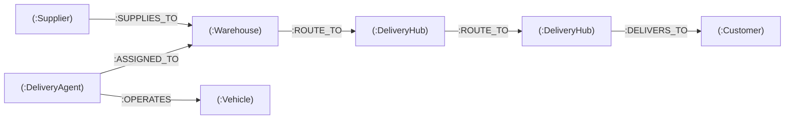

# Graph Database Architecture (Neo4j & Cypher)

## 1. Graph Data Model in Logistics Management

Transportation networks, multimodal freight corridors, and supply chain dependencies naturally form a **network graph**:
* **Vertices (Nodes)**: Warehouses, Regional Sorting Hubs, Suppliers, Customers, Delivery Agents, Vehicles.
* **Edges (Relationships)**: Transportation Corridors (`:ROUTE_TO`), Supply Contracts (`:SUPPLIES_TO`), Last-Mile Deliveries (`:DELIVERS_TO`), and Asset Assignments (`:ASSIGNED_TO`, `:OPERATES`).



---

## 2. Why Graph Databases Over Relational for Routing?

| Comparison Angle | Relational Database (SQL) | Graph Database (Neo4j) |
| :--- | :--- | :--- |
| **Path Traversal Mechanism** | Multi-table self-joins (`JOIN routes r1 ON ... JOIN routes r2 ON ...`) or recursive Common Table Expressions (`WITH RECURSIVE`). | **Index-Free Adjacency**: Each node directly stores memory pointers to its adjacent relationships and neighbors. |
| **Computational Complexity** | **$O(B^d)$** where $B$ is branching factor and $d$ is hop depth. As hops increase, table scan and join costs explode exponentially. | **$O(V \log V + E)$** for weighted Dijkstra shortest paths. Traversal speed is independent of the total size of the database. |
| **Edge Properties** | Requires clumsy bridge tables with foreign keys and compound join queries. | Relationships natively store weighted properties: `distance_km`, `avg_time_mins`, `toll_cost`, `quality_rating`. |
| **Supply Chain Traceability** | Extremely difficult to write arbitrary depth queries (e.g. "Find all customers affected if Supplier X delays shipments"). | Expressed concisely in 3 lines of Cypher: `MATCH (s:Supplier {code:'SUP-001'})-[:SUPPLIES_TO*..5]->(c:Customer) RETURN c`. |

---

## 3. Dijkstra Shortest Path Algorithm Implementation

The Dijkstra algorithm finds the minimum-weight path between origin vertex $s$ and destination vertex $t$:

$$\text{dist}(v) = \min_{(u, v) \in E} (\text{dist}(u) + w(u, v))$$

Where $w(u, v)$ can represent:
1. **Least Distance**: Minimizes fuel consumption and transit wear.
2. **Least Duration**: Minimizes total driver transit hours and SLA breach penalties.
3. **Least Toll Cost**: Minimizes operational highway toll expenditure.

### Cypher Query for Shortest Path:
```cypher
MATCH (origin:Warehouse {code: 'WH-DEL-01'}), (dest:DeliveryHub {code: 'HUB-CHE'})
MATCH path = shortestPath((origin)-[:ROUTE_TO*]-(dest))
RETURN path,
       length(path) AS total_hops,
       [n IN nodes(path) | n.name] AS route_cities,
       REDUCE(totalDist = 0, r IN relationships(path) | totalDist + r.distance_km) AS total_distance_km;
```

---

## 4. Key Cypher Demonstrations for Viva

### 4.1 Supplier-to-Warehouse Procurement Paths
```cypher
MATCH (s:Supplier)-[r:SUPPLIES_TO]->(w:Warehouse)
WHERE w.city = 'New Delhi'
RETURN s.name AS Supplier, s.rating AS Rating, r.lead_time_days AS LeadDays, r.shipping_mode AS Mode;
```

### 4.2 Degree Centrality (Bottleneck Hub Discovery)
Degree Centrality counts the number of relationships connected to a node, identifying vital junctions in the logistics backbone:
```cypher
MATCH (h:DeliveryHub)-[r:ROUTE_TO]-()
RETURN h.code AS HubCode, h.name AS HubName, COUNT(r) AS DegreeCentrality
ORDER BY DegreeCentrality DESC;
```
*Central India Hub (`HUB-NAG` in Nagpur) exhibits the highest degree centrality, indicating it is the most critical cross-docking junction in the country.*

### 4.3 End-to-End Supply Chain Traceability
```cypher
MATCH (s:Supplier)-[:SUPPLIES_TO]->(w:Warehouse)-[:ROUTE_TO*1..3]->(h:DeliveryHub)-[:DELIVERS_TO]->(c:Customer)
RETURN s.name AS OriginSupplier, w.name AS HubWarehouse, c.name AS RecipientCustomer;
```
