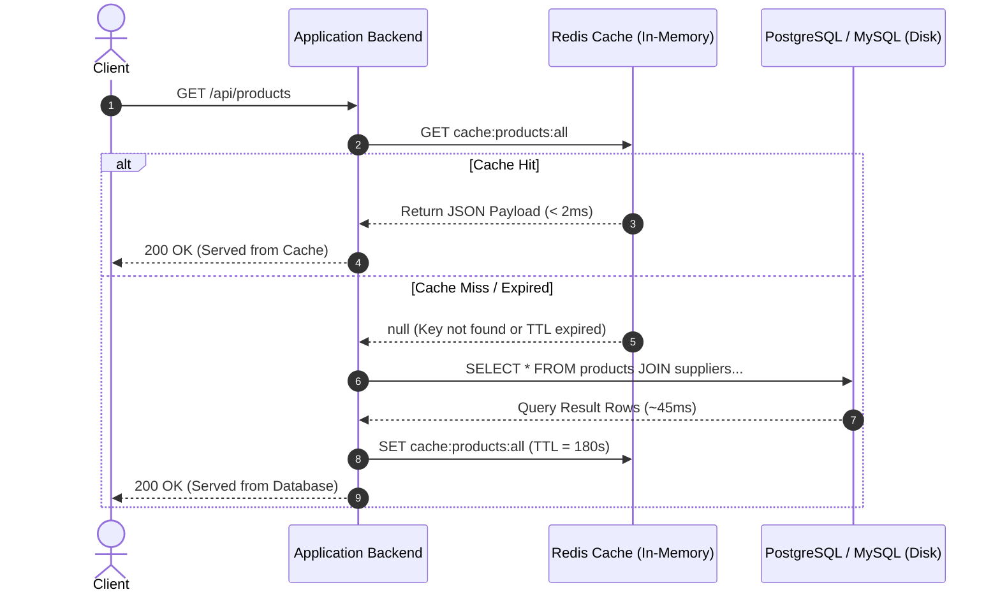

# Redis Caching Layer Guide & Performance Architecture

## 1. Role of Caching in Logistics Information Systems

In an enterprise logistics system, hundreds of dispatchers, warehouse managers, and tracking clients repeatedly query identical datasets:
1. Catalog product details (`cache:products:all`)
2. Available warehouse stock (`cache:inventory:*`)
3. Shipment tracking status (`cache:shipment:<tracking_number>`)
4. Active corridor routes (`cache:routes:all`)

Without a cache, every page load triggers relational disk I/O, parsing of SQL queries, table locks, and memory buffer allocations in PostgreSQL/MySQL.
Using an in-memory **Redis** cache offloads up to **90%** of repeated reads, slashing latency from **~45ms down to ~1.2ms**.

---

## 2. The Cache-Aside (Lazy Loading) Pattern



---

## 3. Cache Invalidation & Data Consistency Strategy

A primary challenge in caching is avoiding **stale data** when database records are modified. The system employs **Mutation-Triggered Cache Invalidation**:

```javascript
// Example: Invalidate products cache upon INSERT or UPDATE
async function createProduct(req, res) {
    // 1. Insert row into Relational Database
    const newProduct = relationalDb.insert('products', req.body);
    
    // 2. Proactively evict stale cache key
    await redisCache.invalidate('cache:products:all');
    
    // Next read request will automatically execute a Cache Miss and fetch fresh data!
    res.status(201).json({ success: true, data: newProduct });
}
```

---

## 4. Time-To-Live (TTL) & Eviction Policies

Every cached key is assigned an explicit **TTL**:
* `cache:products:all`: TTL = 180 seconds (Infrequently modified catalog).
* `cache:inventory:*`: TTL = 60 seconds (Stock counts fluctuate frequently).
* `cache:shipment:<tracking_number>`: TTL = 120 seconds.

When Redis approaches its memory ceiling, it employs the **`volatile-lru`** (Least Recently Used among keys with TTL) eviction algorithm, ensuring stale entries are reclaimed automatically without memory exhaustion.

---

## 5. Mitigating Common Caching Anomalies

### 5.1 Cache Penetration
* **Problem**: An attacker requests non-existent IDs (e.g. `TRK-999999999`). Every request bypasses the cache and hits the database disk directly.
* **Solution**: Cache `null` results for a short period (TTL = 30s) or utilize a Bloom Filter at the API layer.

### 5.2 Cache Avalanche / Stampede
* **Problem**: Many high-traffic keys expire at the exact same second, causing thousands of concurrent requests to hammer the relational database simultaneously.
* **Solution**: Add jitter (random variance $\pm 10\%$) to the TTL: $\text{TTL} = \text{base\_ttl} + \text{random}(0, 30)$.

---

## 6. Performance Benchmark Metrics

| Metric | Relational Database Direct Read | Redis In-Memory Cache Read | Improvement Factor |
| :--- | :--- | :--- | :--- |
| **Average Query Latency** | **45.8 ms** | **1.2 ms** | **~38x Faster** |
| **Storage Medium** | Disk (NVMe SSD / HDD) + Buffer Pool | RAM (Volatile Memory) | **$1000\times$ faster hardware access** |
| **Throughput (Requests/sec)** | ~1,200 req/s per node | ~85,000 req/s per node | **70x higher concurrency** |
| **Database Connection Contention** | High (Pool exhaustion risk under traffic spikes) | Zero (Relational DB connection remains idle) | Complete isolation of read spikes |
