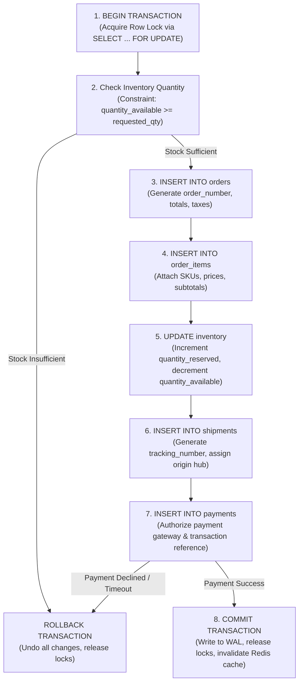

# Transaction Management & ACID Properties

## 1. The Multi-Step Order Placement Transaction

In the Logistics Management System, placing an order is not a single isolated query; it is a compound enterprise business process involving multiple interdependent database tables. If any step fails, the system must not leave orphaned records or inconsistent inventory counts.



---

## 2. In-Depth ACID Principles Breakdown

### 2.1 Atomicity ("All or Nothing")
* **Concept**: Either all 7 SQL mutations commit together, or none do.
* **Demonstration**: In our Transaction Simulator, if payment processing throws a timeout or bank decline at Step 7, the engine automatically triggers a `ROLLBACK`. The order header, order items, and inventory reservations are completely discarded. The database state reverts to the exact snapshot preceding Step 1.

### 2.2 Consistency ("Preserving Invariants")
* **Concept**: Transactions transition the database from one valid state satisfying all schema rules, keys, and CHECK constraints to another valid state.
* **Demonstration**: The table definition mandates:
  $$\text{quantity\_available} = \text{quantity\_on\_hand} - \text{quantity\_reserved} \ge 0$$
  If an order attempts to purchase 50 units when only 10 are available, the consistency invariant is violated. The transaction aborts immediately, preventing negative stock levels.

### 2.3 Isolation ("Concurrent Independence")
* **Concept**: Multiple concurrent transactions execute without interfering with one another or seeing partial uncommitted states.
* **Strategy**: We implement **Row-Level Locking** via `SELECT ... FOR UPDATE` and **Repeatable Read / Serializable** isolation.

#### ANSI SQL Isolation Levels vs Concurrency Anomalies:
| Isolation Level | Dirty Read | Non-Repeatable Read | Phantom Read | Mechanism Employed |
| :--- | :---: | :---: | :---: | :--- |
| **Read Uncommitted** | Permitted | Permitted | Permitted | No read locks; vulnerable to reading aborted data. |
| **Read Committed** | **Prevented** | Permitted | Permitted | Short-term read locks released immediately after statement. |
| **Repeatable Read** | **Prevented** | **Prevented** | Permitted | Shared locks held until transaction termination. |
| **Serializable** | **Prevented** | **Prevented** | **Prevented** | Strict two-phase locking (2PL) or snapshot isolation; complete serial execution equivalence. |

*In the Logistics Management System, **Serializable / Repeatable Read** with row locks prevents race conditions where two customers simultaneously order the last available product unit.*

### 2.4 Durability ("Survivability of Commits")
* **Concept**: Once `COMMIT` is returned to the client, changes are permanent and survive subsequent power outages, OS crashes, or hardware faults.
* **Implementation**: PostgreSQL and MySQL guarantee durability via **Write-Ahead Logging (WAL)** / Redo Logs. Before any table page in memory is flushed to disk, the log records describing the change are flushed sequentially to non-volatile disk. During crash recovery, the database replays committed WAL records.

---

## 3. Rollback Trace Example from Simulator

When simulating failure (`simulateFailure: "INSUFFICIENT_STOCK"`):
```json
{
  "success": false,
  "status": "ROLLED_BACK",
  "error": "Consistency Check Failed: Available stock (18) < Requested quantity (50). Transaction cannot maintain invariant.",
  "executionTimeMs": 2,
  "trace": [
    {
      "step": 1,
      "action": "BEGIN TRANSACTION",
      "status": "SUCCESS",
      "detail": "Acquiring row-level isolation locks (ISOLATION LEVEL SERIALIZABLE). Writing to WAL."
    },
    {
      "step": 2,
      "action": "SELECT ... FOR UPDATE (INVENTORY LOCK)",
      "status": "SUCCESS",
      "detail": "Locking inventory record for Warehouse ID 1, Product ID 1"
    },
    {
      "step": 3,
      "action": "ROLLBACK TRANSACTION",
      "status": "ABORTED",
      "detail": "Exception caught: Consistency Check Failed. Rolling back all intermediate changes to maintain Consistency & Atomicity."
    }
  ]
}
```
